# Mobile screen flow

The mobile site's screens, how you move between them, and the file behind each one.
All signed-in screens are chosen in `src/app/page.tsx` (the mobile branch of its render,
driven by `showMobileHome`, `activeView`, `mobileEmployeeScreen`, `mobileEmployeeId`,
`selectedInquiry` and `mobileClarifying`).

A drawn copy is in [mobile-screen-flow.svg](mobile-screen-flow.svg). Re-draw it after changing the

```mermaid
flowchart TD
  %% ---------- Signed out ----------
  subgraph AUTH["Signed out"]
    WELCOME["ברוכים הבאים<br/><i>components/auth/MobileWelcome.tsx</i><br/>(rendered by app/page.tsx)"]
    SIGNIN["התחברות<br/><i>components/auth/MobileSignIn.tsx</i><br/>(app/sign-in/[[...sign-in]]/page.tsx)"]
    JOIN["בקשת הצטרפות<br/><i>components/auth/MobileJoinRequest.tsx</i><br/>(app/sign-up/[[...sign-up]]/page.tsx)"]
  end
  WELCOME -->|כניסה| SIGNIN
  WELCOME -->|הרשמה| JOIN
  JOIN -->|חזרה לכניסה| SIGNIN
  SIGNIN -->|signed in| HOME

  %% ---------- Always on screen ----------
  subgraph SHELL["On every signed-in screen"]
    HEADER["Header<br/><i>mobile/MobileAppHeader.tsx</i>"]
    MENU["Side menu<br/><i>mobile/MobileMenu.tsx</i><br/>(הגדרות, ארכיון: בקרוב)"]
  end
  HEADER -->|☰| MENU
  HEADER -->|🔔| HOME
  MENU -->|ראשי| HOME
  MENU -->|בירורים פתוחים| INQ
  MENU -->|פורטל מעסיקים| PORTAL
  MENU -->|מסמכים להורדה| DOCS

  %% ---------- Home ----------
  HOME["דף הבית<br/><i>mobile/MobileHome.tsx</i>"]
  HOME -->|"מערכת בירורים (N)"| INQ
  HOME -->|"inquiry row, needs an answer"| CLAR
  HOME -->|"inquiry row, missing an invoice"| MINV
  HOME -->|בירורים כלליים| YEARLY
  HOME -->|"מערכת מעסיקים (N)"| PORTAL
  HOME -->|missing-doc row| MDOC
  HOME -->|סרוק / העלה מסמך חדש| DOCUP

  %% ---------- Inquiries ----------
  subgraph INQUIRIES["מערכת בירורים"]
    INQ["בירורים פתוחים<br/>tabs: הבהרות / חשבוניות חסרות<br/><i>mobile/MobileInquiries.tsx</i>"]
    CLAR["בירור מהות מסמך<br/>form → תשובה נשלחה<br/><i>mobile/MobileInquiryClarification.tsx</i>"]
    MINV["העלאת מסמך חסר<br/>form → תשובה נשלחה<br/><i>mobile/MobileMissingInvoiceUpload.tsx</i>"]
  end
  INQ -->|row in הבהרות| CLAR
  INQ -->|row in חשבוניות חסרות| MINV
  INQ -->|סרוק / העלה מסמך חדש| DOCUP
  CLAR -->|"חזור למסך הבירורים / breadcrumb"| INQ
  CLAR -->|העלה מסמך נוסף| CLAR
  MINV -->|"שמור ועבור למסמך הבא"| MINV
  MINV -->|"last one / חזור למסך הבירורים"| INQ
  MINV -->|העלה מסמך חדש| DOCUP

  %% ---------- Employer portal ----------
  subgraph EMPLOYER["מערכת מעסיקים"]
    PORTAL["מערכת מעסיקים<br/>tabs: מסמכים חסרים / דיווח חודשי / הבהרות<br/>+ collapsible drawer<br/><i>mobile/MobileEmployerPortal.tsx</i>"]
    MDOC["מסמך חסר<br/>(opened inside the portal)<br/><i>mobile/MobileMissingDocUpload.tsx</i>"]
    REPORT["דיווח חודשי לעובד<br/><i>mobile/MobileEmployeeReport.tsx</i>"]
    LIST["עריכת רשימת עובדים<br/>+ archive selected<br/><i>mobile/MobileEmployeeList.tsx</i>"]
    FORM["הוספת / עריכת עובד<br/><i>mobile/MobileEmployeeForm.tsx</i>"]
    ARCHIVE["ארכיון עובדים<br/>(placeholder, empty list)<br/><i>mobile/MobileEmployeeArchive.tsx</i>"]
    UPLOAD["העלאת מסמך לעובד<br/><i>mobile/MobileDocumentUpload.tsx</i>"]
  end
  PORTAL -->|missing-doc row| MDOC
  PORTAL -->|employee row| REPORT
  PORTAL -->|"drawer: עריכת רשימת עובדים"| LIST
  PORTAL -->|"drawer: דוחות חודשיים"| DOCS
  PORTAL -->|"drawer: סרוק / העלה מסמך חדש"| UPLOAD
  MDOC -->|"שמור ועבור למסמך הבא"| MDOC
  MDOC -->|"back / last one"| PORTAL
  MDOC -->|העלה מסמך חדש| UPLOAD
  REPORT -->|חזור לרשימת הדיווחים| PORTAL
  LIST -->|הוספת עובד חדש| FORM
  LIST -->|edit row| FORM
  LIST -->|ארכיון עובדים| ARCHIVE
  LIST -->|חזור למערכת מעסיקים| PORTAL
  FORM -->|"חזור לרשימת הדיווחים / breadcrumb"| LIST
  ARCHIVE -->|breadcrumb| PORTAL
  UPLOAD -->|breadcrumb| PORTAL

  %% ---------- Other ----------
  DOCS["מסמכים להורדה<br/><i>mobile/MobileDocuments.tsx</i>"]
  YEARLY["בירורים כלליים (desktop component)<br/><i>inquiries/components/YearlyForm.tsx</i>"]
  DOCUP["העלאת מסמכים (desktop component)<br/><i>employee/components/DocumentUpload.tsx</i>"]

  classDef desktop fill:#fff4e5,stroke:#c57518;
  class YEARLY,DOCUP desktop;
```

diagram (`mmdc -i <diagram>.mmd -o docs/mobile-screen-flow.svg -b white`).

All component paths are under `src/components/`. Orange boxes are desktop components
that still show inside the mobile layout (no mobile design for them yet).

## Shared building blocks (not screens)

| File | Used for |
|---|---|
| `src/components/mobile/Breadcrumbs.tsx` | The "דף הבית / …" trail at the top of each screen (every crumb but the last goes back) |
| `src/components/mobile/TabbedPanel.tsx` | Gold-framed tabs with "(N)" counts, and the V empty state (`AllClear`) |
| `src/components/mobile/ActionRow.tsx` | A tappable list row with its "השב" action |
| `src/components/mobile/FormRow.tsx` | Form rows, text/select inputs, the file button, save-button styles |
| `src/components/mobile/UploadButton.tsx` | The "סרוק / העלה מסמך חדש" button |
| `src/components/mobile/MaskIcon.tsx` | Recoloured menu icons |
| `src/components/auth/MobileAuthHeader.tsx` | The sign-in/join header and the shared primary/outline button styles |
| `src/lib/inquiries.ts` | `getInquiryGaps` (which tab an inquiry belongs to), `saveMonthlyInquiry` |
| `src/lib/missingDocs.ts` | Fetching missing employee documents, `missingDocKey` |

## Outside this flow

- `src/app/form101/page.tsx`: the Form 101 page an employee opens from their personal link. It is
  not reached from the employer's screens.
- Unsaved changes in an employee's monthly report ask for confirmation before leaving
  (`requestUnsavedConfirmation` in `src/app/page.tsx`).
